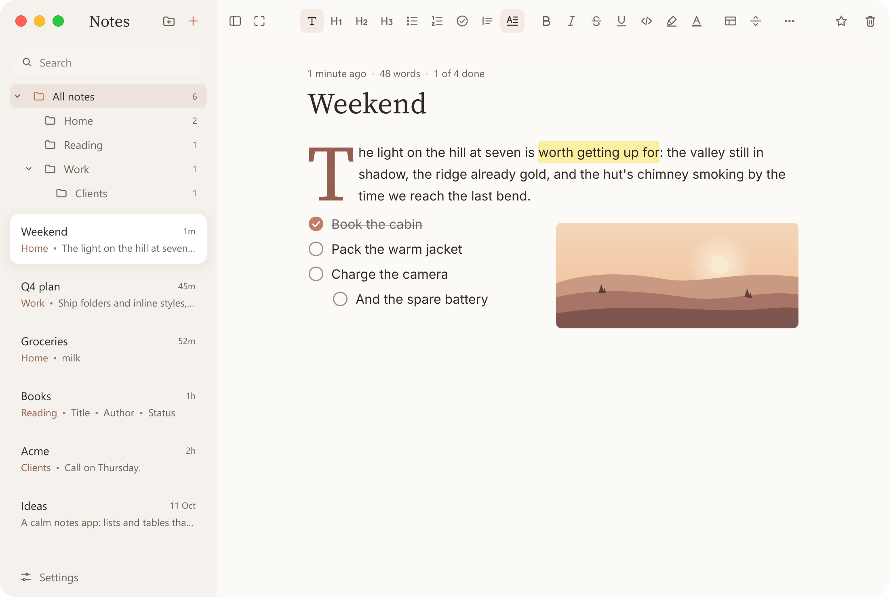
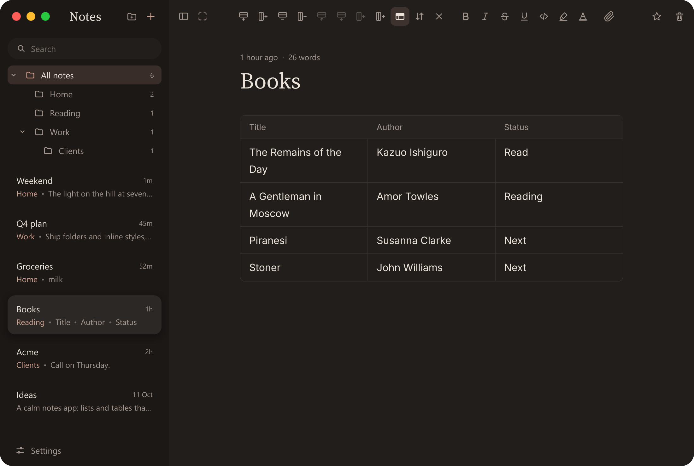
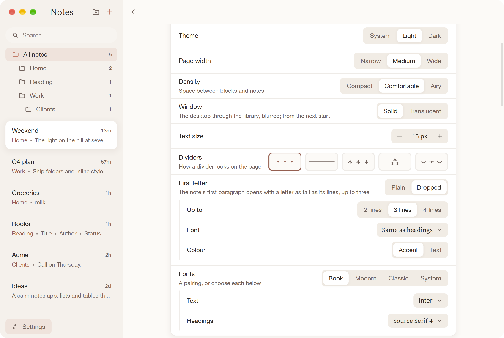
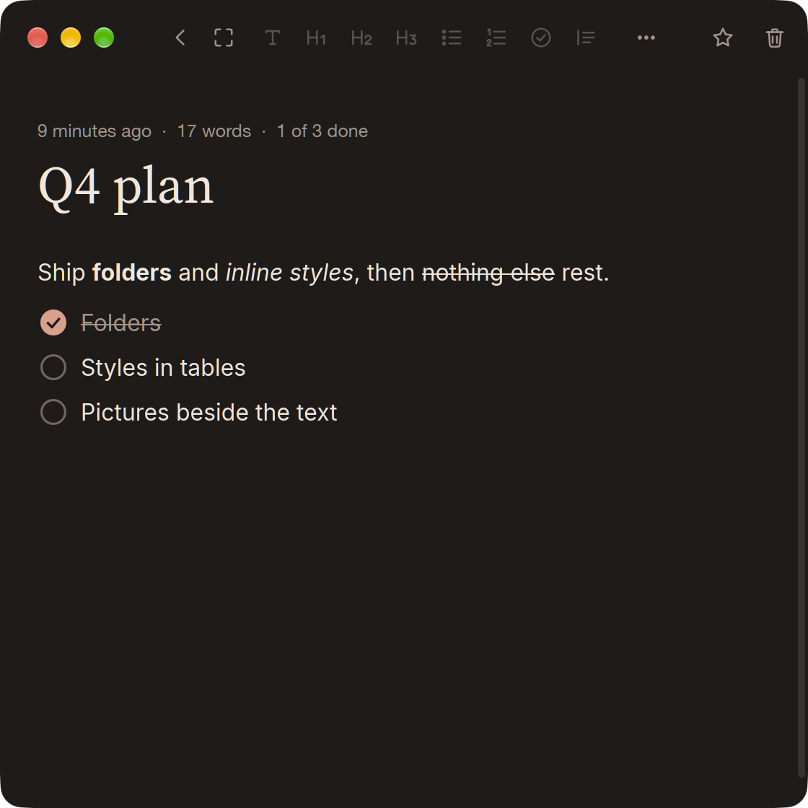
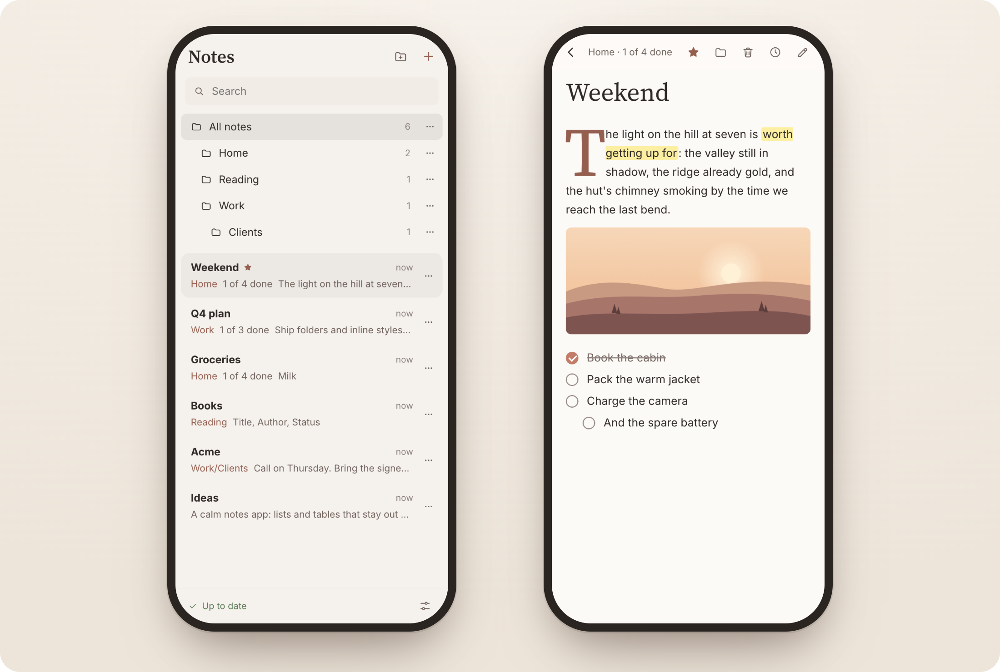

# Carnet

**Notes that open instantly, stay out of your way, and do lists and tables properly.**

Carnet is a small, fast, native notes app for macOS, Windows and Linux. Every note is a plain Markdown file in a folder on your disk, readable and editable by any other tool. It is one binary, with no account, no plugins and no database. Sync between your devices is optional, end-to-end encrypted, and runs on a server you can host yourself; a web app reads and writes your notes from a phone or any browser.

| Light | Dark |
|---|---|
|  |  |

| Settings | A narrow window |
|---|---|
|  |  |

| The web app, on a phone |
|---|
|  |

A *carnet* is French for a small notebook.

## Why Carnet

Carnet is for people who write small, structured things every day: shopping lists, meeting notes with a few action items, comparison tables, packing lists, a running log. It aims for the zero friction of a phone's notes app, on any system, with files you own. It is not a second brain, a graph view or a database.

What it holds to:

1. **Instant.** Starting, switching notes and typing never feel slow. Carnet is native Rust with a GPU-drawn interface, the whole library sits in memory, and nothing on the typing path waits on the network.
2. **Nothing moves unless you moved it.** The note list doesn't re-sort under the pointer while you type, table columns don't shift as you fill them, and everyday actions don't open dialogs. Deleting goes to a trash you can restore from.
3. **Lists and tables are first-class; everything else is plain.** The set of blocks is deliberately small: text, headings, bullet, numbered and checklist items, quotes, tables, code, dividers and pictures.
4. **Your files.** Every note is one GitHub-flavoured Markdown file with a readable name. Checklists are `- [ ]`, tables are pipe tables, and Carnet takes care never to mangle what it reads: a file written in another app keeps its formatting.
5. **Keyboard-natural, mouse-friendly.** Markdown typed at the start of a line becomes a block as you type, Enter continues a list, and Tab and Enter walk a table's cells.

And what it leaves out, on purpose:

- **No plugin system.** The core should do what you need.
- **No databases, relations, formulas or views.** Tables stop at sorting and adding, removing or moving rows and columns.
- **No account to use the app.** Sync is opt-in, open, end-to-end encrypted and self-hostable, and putting the notes folder in Dropbox, iCloud Drive or Syncthing keeps working.
- **No caps on notes or blocks.**

## Features

- **Plain Markdown on disk.** One file per note in `~/Documents/Carnet` (or a folder you choose); folders in it are folders in the app. Pictures go in `attachments/` as ordinary Markdown images.
- **A page that reads as one text.** The caret, selection, copy and undo move across paragraphs, lists and table cells as they would through one document. Markdown's marks are never shown: you see the words, styled, and the file keeps the Markdown.
- **Lists and checklists** that indent and outdent with Tab, continue on Enter and step out on an empty item, with checklist progress ("3 of 7 done") in the line above the title.
- **Tables** with steady columns, Tab and Enter navigation, rows and columns added, removed and moved, and sorting by a column.
- **Edits made in other apps are merged.** A note changed in Obsidian, VS Code or a sync client while it has edits here keeps both sets of edits.
- **History.** Every version a note has been, with what each one added and took away. Restore any of them, or restore one as a copy.
- **Pictures** pasted or dropped in, resized, and placed on their own line or beside the text: photos, screenshots, GIFs, and SVG drawings, which stay sharp however wide they're drawn (their scripts never run).
- **Markdown files dropped in become notes.** Drop `.md` (or `.markdown`) files on a folder in the library and they go into that folder; anywhere else, into the folder the library shows. Each is a copy under its own name (`Plan 2` when `Plan` is taken), the pictures and documents it links to from beside it come along into `attachments/`, and the first one opens. Dropped with pictures, the pictures go into the open note as usual and the Markdown files come in beside it.
- **Copy that keeps formatting.** A selection copies as Markdown with an HTML version beside it, so a paste into Mail, Word or Google Docs keeps headings, lists, checkboxes, tables, bold, underline and links.
- **A trash you can restore from.** Deleted notes and folders go to a trash folder inside your notes folder, and each one goes back where it came from.
- **Calm, readable design.** Five palettes, each light and dark, three densities, font pairings, page widths, text sizes from 12 to 24 px, focus and typewriter modes, and a zen mode that leaves only the note.
- **Sync** between your devices, end-to-end encrypted, through a server you can run yourself, and a **web app** that installs on a phone and works offline.

## Installing

Download the installer for your system from [GitHub Releases](https://github.com/qxuken/carnet/releases). Each file is named for its version, and `SHA256SUMS` beside them lists their checksums.

- **macOS 11 or later** on Apple silicon (Intel Macs are not supported): open `Carnet-<version>-macos.dmg` and drag Carnet onto Applications. The app is not yet signed with an Apple Developer ID, so Gatekeeper stops its first start: open Carnet once, then go to **System Settings → Privacy & Security** and click **Open Anyway**. (`xattr -dr com.apple.quarantine /Applications/Carnet.app` in a terminal does the same.) With sync set up, the first start after an update also asks for your login password, so that the keychain hands the new version its sync keys; **Always Allow** stops it asking again for that version. The first time Carnet opens `Documents/Carnet`, macOS asks whether it may.
- **Windows 10 or later** (x64): run `Carnet-<version>-windows-x64-setup.exe`. It installs for you alone, without asking for an administrator, into `%LOCALAPPDATA%\Programs\Carnet`, with a Start menu entry; **Settings → Apps** uninstalls it, and a newer setup upgrades it in place. The installer is not signed yet, so SmartScreen stops it first: click **More info**, then **Run anyway**. `Carnet-<version>-windows-x64.zip` holds the bare `carnet.exe`, for running without installing.
- **Linux** (x64 or arm64, glibc 2.28 or later: Debian 10, Ubuntu 20.04, Fedora, Arch and their kin): unpack `Carnet-<version>-linux-<arch>.tar.gz` and run `./install.sh`, which puts `carnet` in `~/.local/bin` and Carnet in the applications menu. `./install.sh --uninstall` takes them away again, and `PREFIX=/usr/local` installs for everyone. The binary also runs on its own from the unpacked folder. It needs ALSA (`libasound2`), which every desktop distribution has.

Uninstalling removes the program only: your notes and settings stay where they are.

### Where things are kept

- **Notes:** `~/Documents/Carnet`, one Markdown file per note, unless **Settings → Notes folder** chooses another. Folders whose names start with `.` are left alone. Deleted notes and folders go to `.trash/` inside the notes folder, and `.trash/.origins` remembers where each came from.
- **Settings:** plain `key = value` lines in `settings.txt`, in `%APPDATA%\Carnet` on Windows, `~/Library/Application Support/Carnet` on a Mac and `~/.config/carnet` elsewhere.
- **Each note's history** (what lets Carnet merge edits and show past versions): in the app's data folder, under `replica/` (`%APPDATA%\Carnet`, `~/Library/Application Support/Carnet`, or `~/.local/share/carnet`), never in the notes folder.

A few environment variables override these, which is handy for trying things out: `CARNET_DIR` names the notes folder, `CARNET_CONFIG` the settings file, and `CARNET_THEME=light` or `CARNET_THEME=dark` pins the theme.

## Using it

The page is one editor: the keyboard goes from block to block, and through tables, as it would through one long text. Type `/` on an empty line for the blocks menu, or use Markdown as you type.

On a Mac every shortcut below is the same with ⌘ for Ctrl and ⌥ for Alt; tooltips, menus and the welcome note show them that way, and **Settings → Keyboard** lists them all. Shortcuts follow the key's place, so they work on any keyboard layout (Ctrl+C on a Russian layout is still copy).

### Writing

| You type | You get |
|---|---|
| `- `, `* ` | bullet item |
| `1. ` | numbered item |
| `[] `, `- [ ] ` | checklist item |
| `# `, `## `, `### ` | heading |
| `> ` | quote (Enter goes on a line at a time; on an empty last line, out of it) |
| `---` | divider |
| `--` among the words | an em dash (—), drawn as one letter: the arrows step over it and Backspace takes both dashes. Only the look changes: the file still says `--`, as a divider's says `---`. Not in code, a link's address or HTML; three dashes or more in a line, an arrow (`-->`) and an escaped dash (`\--`) stay as written. The reader and a copy's formatting show it too |
| ```` ``` ```` or `/code` | code block |
| `/table` | 3×3 table |
| `/` on an empty line | the blocks menu: type to narrow it, ↑ ↓ and Enter (or a click) to choose, Esc to type a plain `/` |
| Enter | a new paragraph; in a list, the next item, split at the caret |
| Enter on an empty item | outdent, then leave the list |
| Shift+Enter | a line break inside a paragraph |
| Tab / Shift+Tab | indent / outdent a list item; in a table, the next / previous cell (a new row after the last); elsewhere a tab character |
| Enter in a table | the cell below (a new row at the bottom); in an empty last row, leave the table |
| Backspace at a list item's start | undo its structure (outdent, then plain text), then join the line above |
| Ctrl+Enter | tick or untick a checklist item |
| Ctrl+B / Ctrl+I / Ctrl+Shift+X / Ctrl+E | bold / italic / strikethrough / code |
| Ctrl+U | underline, written `<u>like this</u>`: Markdown has none, and most viewers show the HTML tag |
| Ctrl+Shift+H | highlight, written `==like this==` as Obsidian does |
| Ctrl+K | add, change or remove a link |
| Ctrl+click a link | open it (or a click, or a double-click: Settings → Writing → Open links with) |

The toolbar's highlighter and text-colour buttons offer ten calm hues. They are written as HTML any Markdown viewer shows (`<span style="color: #C0553F">`, `<mark style="background: #F8EBA6CC">`), and Carnet draws each hue in the current theme's own colours. Underline is HTML too, `<u>…</u>`; one written `<ins>…</ins>` in another app is read as underline and kept as it was written.

### Moving around and editing blocks

| Keys | What they do |
|---|---|
| ← → ↑ ↓, Home / End, Ctrl+Home / End | move across blocks and table cells |
| Shift + any of those, or a drag | select, across blocks |
| Ctrl+↑ / Ctrl+↓ | the top or the bottom of the note; with Shift, select to there |
| Esc | select the block the caret is in; Esc again leaves the page |
| Ctrl+A | the block's text; again, the whole note |
| Ctrl+C / Ctrl+X / Ctrl+V | copy and cut (Markdown across blocks); paste (Markdown becomes blocks) |
| Ctrl+Z / Ctrl+Y or Ctrl+Shift+Z | undo / redo anything: typing, ticks, removed blocks and tables |
| Alt+↑ / Alt+↓ | move the block (or the selected blocks) |
| Alt+Shift+↑ / ↓, Ctrl+Alt+Shift+← / → in a table | move the row up or down, the column left or right (the header row stays on top) |
| Ctrl+Alt+0 … 7 | turn the block into text, heading 1–3, checklist, bullets, numbers or a quote |
| Ctrl+Alt+8 | drop the paragraph's first letter, or put it back |
| Ctrl+Alt+T / Ctrl+Alt+- | insert a table / a divider |
| Ctrl+D / Ctrl+Shift+K | duplicate / remove the block (or the selected blocks) |
| drag in the margin | select whole blocks |
| right-click on the page | cut, copy, paste, styles, and what the toolbar does for the block |

The toolbar acts on the blocks the caret touches, and shows only the tools that do something there. In a paragraph, a heading or a quote: turn it into another kind, drop a paragraph's first letter, style its words, insert a table, a divider or files, move or remove the block. In a list: its kinds and back to text, indent and outdent, a checklist item's tick, the styles, insert, move and remove. Inside a table: add, remove or move rows and columns, the header row, sort by the current column, remove the table, the styles, and pictures into the cell. On code or a divider: move it, remove it, insert after it. On a picture: on its own line or beside the words, move it, remove it. A selection over blocks of different kinds gets what applies to any of them, without inserting. As the caret moves into another kind of block, the tools that stay slide over and the new ones fade in; the shortcuts work whatever the toolbar shows. A paragraph's lines turn one at a time, as a paragraph per line typed here would: in a note whose lines end in line breaks (as Apple Notes exports them), the caret's line becomes the item or heading and the lines around it stay as they were; select several lines to turn them all, one item each.

### Notes and folders

| Keys | What they do |
|---|---|
| Ctrl+N / Ctrl+F / Ctrl+S | new note / search / save now |
| Ctrl+Shift+N | new folder |
| Ctrl+Shift+O | the note in a window of its own, the toolbar and the page alone (or from its menu in the list, or the page's); open in both, what is typed in one is in the other at once. Ctrl+W closes it, and so does moving its note to Deleted |
| Ctrl+Alt+↑ / ↓ | the note above or below in the list |
| Ctrl+Tab / Ctrl+Shift+Tab | the next or the previous note the list shows (the folder's, or what the search found, or Deleted), round from the last to the first as a browser's tabs go; from anywhere in the window but Settings, a table cell or a list included. On a Mac too it is Control (⌃⇥), since ⌘Tab is the system's |
| Ctrl+Shift+P / Ctrl+Shift+Backspace | pin the note / move it to Deleted |
| Ctrl+\\ | show or hide the notes list |
| Ctrl+. | zen mode: only the note |
| Ctrl+, | settings |
| F2, Delete or Backspace on a folder in the list | rename it in place, delete it (one with notes goes to Deleted whole, and Undo brings it back) |
| the chevron before a folder, or ← / → on its row | hide or show the folders inside it (Alt: and every folder inside those); → on an open folder goes into it, ← on a closed one goes up to the folder it's in. Which are hidden is kept on each device |
| drag a note or a folder onto a folder | move it there ("All notes" takes it to the top level); a folder takes its notes and folders with it; held a moment over a folder whose folders are hidden, it opens to let you go deeper |
| Shift+click / Ctrl+click in the list | choose several notes and folders, to delete or move together |
| Shift+↑ / ↓ in the list | choose from the folder you're on, or, after a click on a note's card, from that note |
| right-click a note in the list | open, its history, pin, show in Explorer or Finder, copy its path, move to a folder, move to Deleted |

**History** (from a note's menu, or **View → Note History**) lists every version the note has been, newest first: written here, changed in another app, or restored. Click one to read it, with what it changed marked; **Compare with now** shows what restoring it would bring back and take away. **Restore** makes it the note again, and **Restore as a copy** makes it a note of its own.

**Deleted**, under the folders, lists everything in the trash, latest first: click one to put it back where it was.

### Writing in a flow

Once you start typing, the page gets out of the way. The toolbar fades and comes back as soon as you reach for the pointer. The page keeps room under the line you're writing, so you never type at the window's bottom edge. **Focus** (optional) dims every block but the one you're writing, and **Typewriter** keeps the line near the middle of the window. **Zen mode** leaves only the note, with Focus and Typewriter on, and puts everything back as it was when you leave it.

On a narrow window it is one thing at a time: the note, with a back arrow to the list of notes.

### Pictures

- **Ctrl+V** with a picture on the clipboard (a screenshot, an image copied in a browser) puts it in at the caret. Picture files copied in Explorer or Finder, or dragged onto the page, go in the same way.
- A picture is a block of its own: click to select it, then drag a handle to resize it. Right-click it to copy it, size it, place it at the left or right of the text, or show its file.
- A picture at the left or right edge has the text run beside it. It is written ``, Obsidian's width with a side before it.
- **In a table**, drag a picture into a cell. It is drawn as wide as the cell allows and written plainly, ``, as other apps read it.
- The arrow keys choose a picture or a divider whole on their way past it. Typing while one is chosen puts a new paragraph in its place; Enter opens a line beside it and keeps it.
- **Carnet's files and yours.** The files Carnet keeps are the ones in the notes folder's `attachments/` folder, where a paste, a drop, the paperclip or an import puts them. Those sync: pictures, and any file a note links to (a PDF, a sheet, a recording, a `README`, source code, a program). A link opens its file in the app your system has for it; one that could run a program (an `.exe`, an installer, a script, a shortcut) asks first, and opens only with **Open anyway**. Carnet tidies them up: one no note has shown or linked to for a week, in any version of a note, a note in Deleted included, goes to the notes folder's `.trash/attachments/`, where you can still find it. Any other picture a note shows (beside the note, elsewhere in the folder, or outside it) is your own file: Carnet shows it faint, with a small phone in its corner, never syncs it, and never moves or deletes it. Select it to see why, and to **Move into Carnet** (the file goes to `attachments/` and every note showing it follows; the notice's Undo moves it back) or **Copy into Carnet** (a copy for this note alone; your file stays where it is, and the notice's Undo takes the copy away again). On another device (the web, or another computer syncing the notes) such a picture is a grey card the size of the picture's place, saying it's only on the device that has it.

### Settings

Ctrl+, or **Settings** at the foot of the library. Every change applies at once and is saved straight away.

- **Colors**: Linen (the default), Sage, Harbor, Blossom or Graphite, each light and dark; **Theme**: System, Light or Dark.
- **Density**: Compact, Comfortable or Airy.
- **Fonts**: a pairing (Book, Modern, Classic, System); under it, **Text** and **Headings**: any installed family, searchable, each name shown in its own face; and **Code**, for code blocks and `code` words: the system's monospace (SF Mono or Menlo on a Mac, Cascadia Mono or Consolas on Windows, DejaVu Sans Mono or Liberation Mono on Linux), or any installed monospaced family. The web draws code in the browser's system monospace.
- **Page width**: Narrow, Medium or Wide; **Text size**: 12 to 24 px.
- **Dividers**: three dots, a short line, three diamonds, a diamond between lines, or a wave; or your own: **Text**, a few words or marks you type (`~ ✦ ~`, `• • •`) drawn in the page's face, or **Picture**, a picture you pick, drawn a line tall and never wider than the text: PNG, JPEG, GIF, WebP, BMP or an SVG drawing, see-through parts kept. The picture is kept beside the settings file as a PNG no bigger than a divider can use (an SVG drawn into it at that size), so the one you picked can be moved or deleted; one that can't be shown is drawn as three dots, and Settings says why. Only the look changes: the file still says `---`. A settings file naming a style no longer offered opens with the nearest one (stars as dots, a flourish as a wave, a printer's leaf as a diamond between lines).
- **Dropped letters**: a paragraph drops its first letter only when you ask, with the toolbar's **Drop the first letter** (Ctrl+Alt+8): a large letter, the first lines beside it, as tall as the paragraph's lines up to a limit: a two-line paragraph drops two, a one-line one none. The file keeps it as `<span class="initial">O</span>nce`, which other Markdown apps show as a plain letter. For every dropped letter: **Up to** (two, three or four lines), **Font** (the heading face, or any other) and **Colour** (the accent's or the text's; a letter given a colour of its own with the text-colour tool keeps it). The settings' preview shows one.
- **Toolbar**: always shown, or fading while you type; **Focus** and **Typewriter**, as above.
- **Window**: the notes list shows the desktop through it, blurred, where the system can (macOS, Windows 11, KDE); **Solid** turns that off from the next start.
- **Sort notes by**: last edited, title or created (pinned notes stay on top).
- **Dates**: on the page and the cards, when a note was last edited or when it was created: how long ago within a day ("3 hours ago"), the day after that ("Created 9 October", the year too when it is not this one).
- **Notes folder**: change it, show it, copy its path, or go back to `Documents/Carnet`.
- **Sync**: see below.
- **About**: this version, and, when GitHub has a newer release, "Carnet 0.1.2 is out" with **Download**, which opens the release's page (nothing is installed; a notice says so once, too). **Check for updates** (on by default) asks GitHub once a day, at start and then every 24 hours while Carnet runs: one request to `api.github.com` for the latest release, with nothing sent but the request itself (no account, no id, nothing about your notes). Off, nothing is asked. A check that fails says nothing, and offline it simply waits.
- **Advanced → Mouse wheel**: how far a notch scrolls and how it glides there. **Carnet** (60 px, a long soft glide) is the default; **Gentle**, **Standard**, **Brisk** and **Swift** are kui's presets. `KUI_WHEEL` (a preset's name, or `line_px,response,kick`) overrides it while it's set.
- **Add the getting-started note**, last of all, brings back the "Welcome to Carnet" note a new notes folder starts with (on a Mac, **Help → Getting Started Note** too). If one nobody has written in is still there, that one opens; otherwise a fresh one is added at the top of the notes folder, saved and synced like any note.

Carnet sets its pages in fonts it ships, so they look the same on every machine: **Source Serif 4** for titles and headings and **Inter** for the text, both under the SIL Open Font License. Code is set in the system's own monospace, which every machine has.

## Sync and self-hosting

Sync is off until you turn it on in **Settings → Sync**. Once it is on, each note is merged across your devices rather than copied: edits made on two devices while offline both survive. The notes stay plain files in your notes folder either way.

Sync is end-to-end encrypted. Your notes, their titles, folder names and files are sealed on your devices before they leave; the server stores and passes on what it cannot read. It does see some metadata, such as how many notes there are, their sizes, and when they change. [docs/SYNC.md](docs/SYNC.md) describes the design, and its §7 covers the encryption and what the server can see.

To start, you need a sync server and an invite code from it:

1. **Run `carnet-server`**, from the released image (`qxuken/carnet-server` on Docker Hub, or `ghcr.io/qxuken/carnet-server`) or built from this repository. On its first start it prints an invite code for the first account, good for a day (restart the server for a new one). [crates/carnet-server/README.md](crates/carnet-server/README.md) is the full self-hosting guide: running it, TLS, backups, monitoring, and moving to Postgres and S3.
2. **In Carnet, open Settings → Sync**, type the server's address, choose **Enter the code**, and type the invite code.
3. **Add your other devices** from **Settings → Sync → Add a device**: it shows a code (and a QR code) that the new device types or scans. The server only relays the two devices' messages and cannot read what passes between them.
4. **Keep a way back in.** Twelve recovery words let a new device in when none of yours is left; they are shown once and kept nowhere. A password (and, in the web app, a passkey) does the same and can be changed at any time; the server never learns the password.

The first account on a server is its owner's: the owner's devices can invite other people, each with an account and notes of their own.

## The web app

`carnet-server` also serves a web app at its address. Open it in a browser and type a pairing code from one of your devices, or scan the QR code with a phone's camera, and the browser becomes one of your devices. It reads, searches and edits your notes the way the desktop does, with pictures, tables and checklists; makes, renames, nests and deletes folders, moves notes between them and pins them; shows a note's history; lists and removes devices; and keeps working offline. Install it from the browser's menu, or with **Share → Add to Home Screen** on an iPhone. It decrypts in the browser, like the desktop app.

## Building from source

You need a recent stable [Rust](https://rustup.rs) (Carnet uses the 2024 edition, so 1.85 or later). On Linux, also `pkg-config` and ALSA's headers (`libasound2-dev` on Debian and Ubuntu, `alsa-lib-devel` on Fedora).

```bash
git clone https://github.com/qxuken/carnet.git
cd carnet
cargo run --release
```

Carnet is built on [kui](https://drydock9.qxuken.dev/qxuken/kui), its author's native UI framework, taken from crates.io as [`kui-native`](https://crates.io/crates/kui-native) at the exact version `Cargo.toml` pins. The fonts in `assets/fonts/` are ordinary files in the repository and are built into the binary.

The web app is built with Node and Rust's `wasm32-unknown-unknown` target; [CONTRIBUTING.md](CONTRIBUTING.md) has the steps, along with tests, packaging and releasing.

## Project layout

| Path | What |
|---|---|
| `src/` | the desktop app: the window, the page, the library, settings, and sync on this device |
| `crates/carnet-core/` | the note's Markdown model and the page editor's logic, with no UI in it, so it also builds for the web |
| `crates/carnet-sync/` | each note as a CRDT, and a device's side of sync: its encryption and its wire format |
| `crates/carnet-server/` | the sync server ([its README](crates/carnet-server/README.md)) |
| `crates/carnet-web/` | the web app's Rust, compiled to WebAssembly |
| `web/` | the web app (Svelte 5), served by `carnet-server` |
| `packaging/` | installers for macOS, Windows and Linux, the server's container, and a Grafana dashboard and alerts for the server |
| `fuzz/` | fuzz targets |
| `docs/` | the sync design ([docs/SYNC.md](docs/SYNC.md)) and the screenshots |

## Contributing and security

Contributions are welcome: see [CONTRIBUTING.md](CONTRIBUTING.md) for how to build, test and send changes. To report a security problem privately, see [SECURITY.md](SECURITY.md).

## Licence

Carnet is under either of

- the Apache License, Version 2.0 ([LICENSE-APACHE](LICENSE-APACHE)), or
- the MIT License ([LICENSE-MIT](LICENSE-MIT)),

at your option. A contribution you submit for inclusion is licensed the same way, as defined in the Apache-2.0 licence, with no additional terms or conditions. The fonts in `assets/fonts/` are under the SIL Open Font License, beside them.
